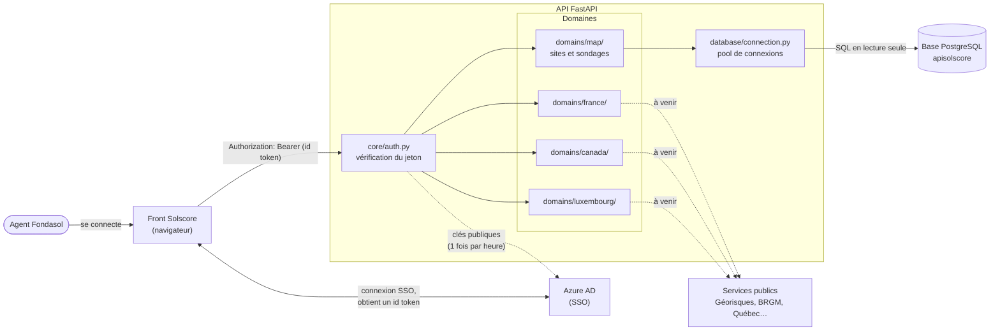
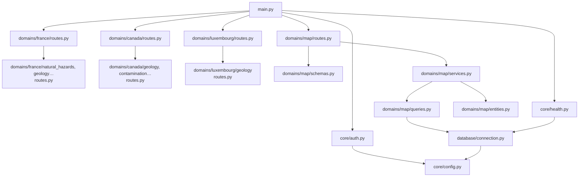
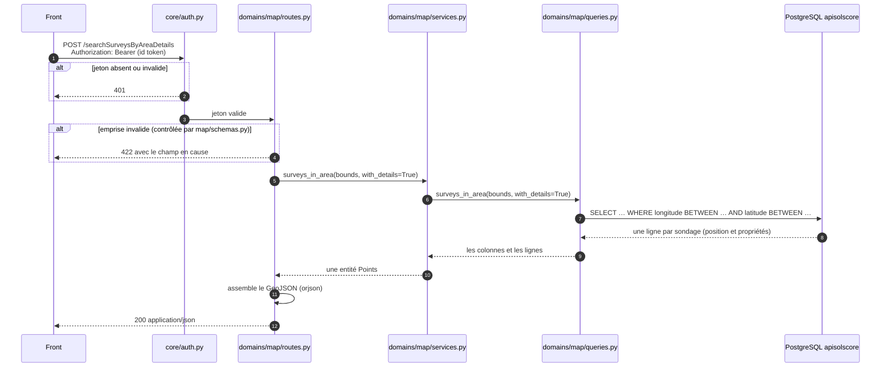

# Architecture de l'API Solscore

Ce document explique comment l'API est construite, comment le code est rangé et
comment le faire évoluer. Il s'adresse à toute personne qui doit lire ou modifier le
code, sans prérequis en architecture logicielle.

Ce projet sert de **modèle** pour structurer l'API apisolscore : il pose l'organisation
du code, la sécurité et les conventions.

---

## 1. Ce que fait l'API

L'API rend deux types de services au front Solscore :

- **les données internes de Fondasol** : les sites et les sondages à afficher sur la
  carte, lus directement dans la base PostgreSQL d'apisolscore (`app/domains/map/`, déjà en
  place) ;
- **les données d'enquête par pays** : aléas naturels, géologie, environnement…,
  obtenues auprès de services publics (Géorisques, BRGM, données du Québec…). Leur
  structure est prête dans `app/domains/france/`, `app/domains/canada/` et `app/domains/luxembourg/` ; les routes
  restent à y ajouter.

Chaque appel doit porter le jeton de l'utilisateur connecté au front par SSO (Azure AD).

| Technologie | Rôle |
|---|---|
| **FastAPI** | le framework web : routes, validation des requêtes, documentation `/docs` |
| **Pydantic** | la description et le contrôle des données reçues et renvoyées, et de la configuration |
| **SQLAlchemy + psycopg** | la connexion à PostgreSQL et l'exécution du SQL |
| **PyJWT + httpx** | la vérification du jeton Azure |
| **Uvicorn** | le serveur qui fait tourner l'application |
| **Docker Compose** | le lancement en local |

---

## 2. Vue d'ensemble



**À retenir :**
- Le front obtient un **id token** auprès d'Azure au moment de la connexion SSO, puis
  l'envoie à chaque appel dans l'en-tête `Authorization`.
- Tous les domaines passent par la même vérification du jeton.
- `map/` lit la base de Fondasol. Les domaines par pays interrogeront des services
  publics ; les flèches en pointillé sont à venir.

---

## 3. Organisation du code

```
back-fastapi/
├── app/
│   ├── main.py                          crée l'application et branche les domaines
│   ├── core/                            technique, partagé par tous les domaines
│   │   ├── config.py                    lit et vérifie la configuration (.env)
│   │   ├── auth.py                      vérification du jeton (Azure et jeton de dev)
│   │   ├── health.py                    sonde /api/health
│   │   ├── logger.py                    journal : un fichier texte par jour dans logs/
│   │   ├── warmup.py                    au démarrage : clés Azure et connexions à la base prêtes
│   │   ├── timing.py                    chronomètre les étapes d'une requête (base, GeoJSON…)
│   │   ├── audit.py                     trace chaque requête (qui, quoi, comment, quand) dans le journal et la base d'audit
│   │   ├── errors.py                    erreurs métier (NotFound, Conflict…) et leur code HTTP
│   │   ├── body.py                      lecture d'un corps JSON contrôlé par les règles métier (400)
│   │   └── profile.py                   profil de l'agent connecté dans la base métier (table users)
│   ├── database/                        accès aux bases, partagé par tous les domaines
│   │   └── connection.py                connexions à apisolscore, à la base métier et à la base d'audit
│   └── domains/                         métier
│       ├── profile/                     profil de l'agent connecté : préférences et favoris → /me/…
│       ├── projects/                    affaires, sondages, repositionnement, référentiels, GED → /projects/…
│       ├── investigations/              enquêtes enregistrées et leurs versions → /investigations/…
│       ├── socle/                       paramétrage, statistiques, zones restreintes, images d'attente
│       ├── reports/                     archive ZIP des rapports, lus sur le dépôt FTP → /reports
│       ├── desk_study/                  planches de l'enquête documentaire, fiches Infoterre
│       ├── map/                         données Fondasol : sites et sondages (tous pays)
│       │   ├── routes.py                les URL : reçoit la requête, appelle le service, renvoie la réponse
│       │   ├── schemas.py               le contrat de l'API : vérifie les entrées, décrit les sorties
│       │   ├── services.py              le métier : récupère les données, applique les règles et calculs
│       │   ├── entities.py              les objets métier manipulés par le service (ici, les points)
│       │   └── queries.py               le SQL : lit la base de données
│       ├── france/                      données d'enquête France          → /fr/…
│       │   ├── routes.py                regroupe les thèmes de la France
│       │   ├── natural_hazards/         aléas naturels                    → /fr/natural-hazards/…
│       │   │   ├── routes.py            mêmes fichiers que map/, vides pour l'instant
│       │   │   ├── schemas.py
│       │   │   ├── services.py
│       │   │   ├── entities.py
│       │   │   ├── sources.py           les appels aux services externes (Géorisques…)
│       │   │   └── queries.py
│       │   ├── geology/                 … et de même dans chaque thème
│       │   ├── urban_planning/          PLU, PPR
│       │   ├── environment/             sites pollués, zones naturelles, CatNat, cavités…
│       │   ├── hydrogeology/            BSS, ADES
│       │   └── weather/
│       ├── canada/                      données d'enquête Canada          → /ca/…
│       │   ├── routes.py                regroupe les thèmes du Canada
│       │   ├── geology/
│       │   ├── contamination/           GTC, FCSI, sites contaminés…
│       │   ├── environment/             milieux naturels, faune, eau…
│       │   └── infrastructure/          pipelines, RBQ, NPRI
│       └── luxembourg/                  données d'enquête Luxembourg      → /lu/…
│           ├── routes.py                regroupe les thèmes du Luxembourg
│           └── geology/
├── migrations/                          migrations Alembic du schéma de la base métier
│   └── versions/                        une révision par changement de schéma (0001 : schéma de départ)
├── alembic.ini                          configuration d'Alembic
├── tests/                               même arborescence que app/
├── docs/
│   └── architecture.md                  ce document
├── Dockerfile
├── docker-compose.yml
├── pyproject.toml                       dépendances Python (ce dont l'API a besoin)
├── requirements.txt                     versions exactes installées (généré par pip-compile)
├── .env.example                         modèle de configuration (versionné)
└── .env                                 configuration réelle (non versionnée)
```

**Trois dossiers, trois rôles :**
- `app/core/` : le **technique**, partagé par tous (configuration, sécurité, sonde). On
  y touche rarement.
- `app/database/` : la **connexion à la base** d'apisolscore, utilisée par les domaines
  qui lisent la base. On y touche rarement aussi.
- `app/domains/` : le **métier**. C'est là qu'on ajoute les fonctionnalités.

Chaque thème contient déjà tous les fichiers du modèle (voir plus bas). Ils sont vides,
avec une ligne de commentaire qui dit à quoi ils servent, sauf `routes.py`, qui déclare
le routeur du thème avec son préfixe d'URL et son étiquette dans `/docs` :

```python
from fastapi import APIRouter

router = APIRouter(prefix="/natural-hazards", tags=["France - Natural hazards"])
```

Ces routeurs sont déjà branchés : une route ajoutée dans un thème est aussitôt disponible
et protégée. Les thèmes sans route n'apparaissent pas encore dans `/docs`.

### Le principe : découper là où le code est vraiment différent

Le code est rangé **par sujet métier**, pas par type de fichier technique. Pour
comprendre ou modifier une fonctionnalité, on ouvre un seul dossier.

**Premier niveau : le pays**, pour les données d'enquête. D'un pays à l'autre, tout
change : les sources (Géorisques en France, le Géoportail au Luxembourg, les registres
du Québec), les concepts (PPR et ZNIEFF sont français, NPRI et RBQ sont canadiens), et
même la forme des réponses pour un thème commun comme la géologie. Il n'y a presque rien
à partager entre pays.

**Second niveau : le thème métier**, à l'intérieur de chaque pays : aléas naturels,
géologie, environnement… Sans lui, `france/` deviendrait un fourre-tout de 18 routes.

**Exception : `map/`**, qui n'est pas découpé par pays. Ce sont les données internes de
Fondasol : un sondage reste un sondage, qu'il soit en France ou au Canada.

### Ce qu'on trouve dans un domaine

Chaque thème suit **toujours la même structure** :

```
canada/contamination/
├── routes.py      HTTP
├── schemas.py     contrat de l'API (Pydantic)
├── services.py    logique métier, algorithmes
├── entities.py    objets métier manipulés par les algorithmes
├── sources.py     données des services externes
└── queries.py     données de la base (SQL)
```

| Fichier | Contient | Ne contient pas |
|---|---|---|
| `routes.py` | les routes : URL, lecture de la requête, appel du service, conversion du résultat en réponse | de SQL, d'appel HTTP direct, de calcul métier |
| `schemas.py` | le contrat de l'API : forme des données reçues et renvoyées, et leurs contrôles (Pydantic) | d'accès aux données, de calcul |
| `services.py` | la logique métier et les algorithmes : règles, calculs, croisement de sources | de notion HTTP (requête, statut, `Response`) |
| `entities.py` | les objets métier manipulés par les algorithmes (dataclasses) : `ContaminatedSite`, `RiskScore`… | de modèle de table, de notion HTTP |
| `sources.py` | les appels aux services externes, une fonction par appel | de mise en forme de la réponse de l'API |
| `queries.py` | le SQL, une fonction par requête, avec des paramètres `:nom` | de notion HTTP |

`sources.py` et `queries.py` font le même travail, ramener les données, depuis deux
origines différentes. Les deux sont présents dans chaque thème. Quand on écrit la
première route, on supprime celui qui ne sert pas.

**`schemas.py` ou `entities.py` ?** `schemas.py` décrit ce que voit le front ;
`entities.py` décrit ce que manipulent les algorithmes. Les services travaillent sur les
entités, et seules les routes convertissent vers les schémas. On peut ainsi faire
évoluer un algorithme sans changer la réponse de l'API, et inversement.

Une **entité** est une « chose » du métier que le code manipule en interne : un site
contaminé, un sondage, une zone sismique, un score de risque… Par exemple, dans
`canada/contamination/` :

```python
# entities.py
from dataclasses import dataclass

@dataclass
class ContaminatedSite:
    name: str
    latitude: float
    longitude: float
    contaminants: list[str]      # ["plomb", "hydrocarbures"]
    status: str                  # "actif", "réhabilité"

@dataclass
class RiskScore:
    level: str                   # "faible", "moyen", "élevé"
    nearest_site: ContaminatedSite
    distance_m: float
```

`sources.py` récupère les sites auprès du registre canadien et les transforme en
`ContaminatedSite`. `services.py` fait le calcul sur ces objets :

```python
# services.py
def risk_score(sites: list[ContaminatedSite], latitude: float, longitude: float) -> RiskScore:
    nearest = min(sites, key=lambda site: distance(site, latitude, longitude))
    ...
    return RiskScore(level="élevé", nearest_site=nearest, distance_m=120)
```

L'algorithme ne manipule jamais le JSON brut du registre
(`site["properties"]["contam_list"]`…), qui dépend du format de la source : il manipule
des objets aux noms métier. La route reçoit le `RiskScore` et en tire la réponse
destinée au front (`RiskResponse` dans `schemas.py`, par exemple seulement `level` et
`distance_m`).

| | `entities.py` | `schemas.py` |
|---|---|---|
| Pour qui ? | le code interne (les algorithmes) | le front (ce qu'il envoie et reçoit) |
| Exemple | `ContaminatedSite`, avec tous ses détails | `RiskResponse` : juste `level` et `distance_m` |
| Change quand… | l'algorithme évolue | le contrat avec le front évolue |

En résumé : `entities.py` décrit **de quoi parle le métier**, `schemas.py` décrit **ce que
l'API échange avec l'extérieur**.

`map/` suit la même structure, sans `sources.py` puisque ses données viennent de la
base. C'est l'exemple complet à suivre : `routes.py` appelle `services.py`, qui appelle
`queries.py` et renvoie une entité `Points` (définie dans `entities.py`) ; la route la
convertit en GeoJSON. Son service est simple, car la carte ne fait que lire et renvoyer ;
c'est lui qui accueillera un éventuel regroupement des points ou un tri par proximité.

**Le sens des appels est toujours le même :**

```
routes.py  →  services.py  →  sources.py / queries.py
   HTTP         métier            données
```

Aucun fichier n'appelle « vers le haut » : `sources.py` ne connaît pas le service, le
service ne connaît pas la route.

**Les algorithmes sont des fonctions pures.** Le service fait deux choses : il récupère
les données (via `sources.py` ou `queries.py`), puis il appelle les fonctions de calcul
en leur passant ces données. Une fonction de calcul reçoit des données et renvoie un
résultat, sans accès à la base, au réseau ni à HTTP. On peut alors la tester avec un
petit jeu de données écrit à la main, sans base ni connexion, comme une fonction de
notebook :

```python
# services.py
def contamination_risk(latitude: float, longitude: float) -> RiskScore:
    sites = sources.contaminated_sites_near(latitude, longitude)   # 1. les données
    return risk_score(sites, latitude, longitude)                  # 2. le calcul

def risk_score(sites: list[ContaminatedSite], latitude: float, longitude: float) -> RiskScore:
    ...  # calcul pur : testable avec une liste de sites inventée

# ContaminatedSite et RiskScore sont définis dans entities.py
```

**Un fichier par responsabilité, un dossier quand ça grossit.** Tant qu'un thème reste
lisible, chaque responsabilité tient dans un fichier. Quand un fichier devient trop gros,
il devient un dossier du même nom, sans changer la logique :

```
canada/contamination/
├── routes.py
├── schemas.py
├── services.py
├── entities.py
├── algorithms/          quand les calculs deviennent nombreux
│   ├── risk_score.py
│   └── proximity.py
└── sources/             quand les services externes se multiplient
    ├── gtc.py
    └── fcsi.py
```

**Pas de `repositories/`** : `sources.py` et `queries.py` jouent déjà ce rôle.

**Pas de `models.py` dans les thèmes.** Par convention, `models.py` désigne les modèles
SQLAlchemy, c'est-à-dire la description des tables. Une table n'appartient pas à un
thème : `site` ou `sondage` servent à `map/` et pourront servir à d'autres thèmes. Si on
décrit un jour les tables en modèles SQLAlchemy, ils iront dans `app/database/models.py`,
à côté de la connexion. Ce n'est pas utile aujourd'hui : la base apisolscore est lue en
lecture seule, sans migrations, et le SQL de `queries.py` est plus rapide et plus lisible.
Ces modèles deviendront utiles le jour où l'API écrira dans une base qui lui appartient.

### Les URL suivent les dossiers

| Dossier | URL |
|---|---|
| `app/domains/map/` | à la racine, pour garder le contrat actuel du front : `/searchSitesByArea`… |
| `app/domains/france/natural_hazards/` | `/fr/natural-hazards/…` |
| `app/domains/canada/contamination/` | `/ca/contamination/…` |
| `app/domains/canada/land_registry/` | `/ca/land-registry/lots` (Cadastre allégé du Québec) |
| `app/domains/luxembourg/geology/` | `/lu/geology/…` |

Conventions : code pays ISO (`fr`, `ca`, `lu`), noms en anglais, mots séparés par des
tirets dans les URL et par des soulignés dans les noms de dossiers.

Le code est écrit **en anglais** (dossiers, fichiers, fonctions, variables) ; seule la
documentation est en français.

### Qui dépend de qui



La règle : **un domaine peut utiliser `core/` et `database/`, eux n'utilisent jamais
un domaine**, et un pays n'utilise jamais un autre pays. C'est ce qui permet de faire
évoluer la France sans risquer de casser le Canada.

`main.py` connaît les pays ; chaque `routes.py` de pays connaît ses thèmes. Personne
d'autre n'a besoin de connaître la liste complète.

---

## 4. Le parcours d'une requête

Exemple : le front affiche les sondages d'un quartier de Paris.



1. **CORS** : si l'appel vient d'un navigateur, l'origine du front doit être dans
   `CORS_ORIGINS`.
2. **Authentification** : `core/auth.py` vérifie le jeton avant même que la route
   soit appelée.
3. **Validation** : FastAPI contrôle la requête avec le `schemas.py` du domaine. Une
   requête invalide est refusée (422) **avant** tout accès aux données.
4. **Métier** : `services.py` récupère les données et applique la logique métier.
5. **Données** : `queries.py` interroge la base (ou `sources.py` un service externe).
6. **Réponse** : `routes.py` convertit le résultat du service et le renvoie.

---

## 5. Authentification

Toutes les routes métier exigent un jeton. Seule `/api/health` est publique, ainsi que
`/docs` et la redirection de `/` vers `/docs`.

La protection est posée **une seule fois par pays ou domaine**, dans `main.py` :

```python
protected = [Depends(current_user)]

app.include_router(map_router, dependencies=protected)
app.include_router(france_router, dependencies=protected)
```

Une route ajoutée dans n'importe quel thème est donc protégée automatiquement.

### Le jeton Azure (utilisation normale)

Le front envoie l'**id token** obtenu à la connexion SSO. `core/auth.py` vérifie :

| Contrôle | Ce qui est vérifié |
|---|---|
| Signature | le jeton a bien été signé par Azure (algorithme RS256, clés publiées par le tenant) |
| Émetteur | `iss` correspond à `OIDC_ISSUER` (notre tenant Azure) |
| Audience | `aud` correspond à `OIDC_AUDIENCE` (notre application) |
| Expiration | le jeton n'est pas expiré (durée de vie : environ une heure) |
| Identité | le jeton contient `preferred_username` (l'adresse de l'agent) |

Si un seul contrôle échoue, l'API répond **401**.

### Le jeton de développement

Pour travailler en local sans aller chercher un id token, un jeton fixe peut être défini
dans le `.env` :

```dotenv
APP_ENV=dev
AUTH_DEV_TOKEN=<au moins 32 caractères, par exemple : openssl rand -hex 32>
AUTH_DEV_USER=dev@fondasol.fr
```

Garde-fous :
- il n'est accepté que si `APP_ENV=dev` ;
- s'il est défini avec une autre valeur d'`APP_ENV`, **l'API refuse de démarrer** ;
- il doit faire au moins 32 caractères ;
- il est comparé en temps constant, pour qu'on ne puisse pas le deviner caractère par
  caractère ;
- les jetons Azure restent acceptés en même temps.

> Ne jamais le définir sur un serveur partagé : quiconque le connaît accède à l'API
> sans passer par Azure.

---

## 6. Base de données

| Table | Colonnes utilisées par `map/` |
|---|---|
| `public.site` | `uuid`, `latitude`, `longitude`, `affaire_id` |
| `public.affaire` | `id`, `numero`, `nom` |
| `public.sondage` | `id`, `nom`, `site_uuid`, `localisation_longitude_xwgs84`, `localisation_latitude_ywgs84`, `has_mesure_pressiometrique` |

- **La base renvoie des lignes simples, l'API assemble le GeoJSON.** Chaque requête
  renvoie une ligne par point : `longitude`, `latitude` (déjà arrondies à 6 décimales),
  puis les propriétés, dont les noms de colonnes sont ceux attendus dans le JSON
  (`AS affaire_numero`…). Les requêtes sont construites par `points_sql()`
  (`map/queries.py`). Le service les enveloppe dans une seule entité `Points` (noms des
  propriétés et lignes), sans créer d'objet par point. `_geojson()` (`map/routes.py`)
  les met ensuite au format GeoJSON avec
  `orjson`, une bibliothèque de sérialisation JSON très rapide. Les lignes sont lues
  telles quelles (des tuples) et associées aux noms des colonnes, sans être converties
  une à une en dictionnaires.

  Ce sont deux choix de performance mesurés sur 26 000 sondages, en alternant les appels
  entre deux versions au même moment, pour un contenu identique :

  | Version | Temps de réponse |
  |---|---|
  | JSON construit par PostgreSQL (`json_build_object`, `json_agg`) | 0,63 s |
  | Lignes simples, converties en dictionnaires, JSON assemblé par l'API | 0,37 s |
  | Lignes simples lues comme tuples, JSON assemblé par l'API (actuel) | **0,29 s** |

  Construire le JSON dans PostgreSQL occupait un seul cœur de la base pendant environ
  200 ms, et produisait un texte 10 % plus gros à faire transiter depuis la base distante.

  **Contrainte à respecter** : dans `points_sql()`, `longitude` et `latitude` doivent
  rester les deux premières colonnes. `_geojson()` s'appuie sur leur position.

  Pour ajouter une propriété à une route, il suffit d'ajouter une colonne avec le bon nom
  (`AS nom_dans_le_json`) dans `SITE_PROPERTIES` ou `SURVEY_PROPERTIES`.
- **Le SQL est toujours paramétré** : les valeurs reçues du front passent par des
  paramètres (`:minLng`, `:maxLat`…), jamais par concaténation. Les f-strings de
  `queries.py` n'assemblent que des morceaux de SQL écrits dans le code. Aucune injection
  SQL n'est possible.
- **Pool de connexions** : la base est distante (environ 100 ms pour ouvrir une
  connexion). `database/connection.py` garde jusqu'à 5 connexions ouvertes (15 en pic) et
  les réutilise. Une connexion coupée est détectée et remplacée automatiquement.

### La base métier (`refonte`)

Depuis l'ADR-0034 du front (14/10/2026), back-fastapi remplace le back Symfony, lot par lot.
Il écrit donc dans la base métier de la refonte (PostgreSQL + PostGIS, conteneur
`refonte_postgis` en local) : affaires, sondages, profils, favoris, enquêtes. L'entrepôt
d'apisolscore reste en lecture seule, pour la carte.

| Fonction (`database/connection.py`) | Rôle |
|---|---|
| `refonte_rows(sql, **paramètres)` | lecture : liste de dictionnaires (colonne → valeur) |
| `refonte_row(sql, **paramètres)` | lecture : première ligne, ou `None` |
| `refonte_transaction()` | écriture : `with refonte_transaction() as connection:` ouvre une transaction validée à la sortie du bloc, annulée en cas d'erreur |

**Schéma** : tenu par Alembic (`migrations/versions/`). Doctrine (back Symfony) ne crée plus
rien. La révision `0001` est le schéma de la base au 14/10/2026, extrait par `pg_dump` ; elle
crée toutes les tables sur une base vide. Sur une base déjà créée par Symfony, on ne
l'applique pas : on la marque à jour.

```bash
docker compose exec api alembic stamp 0001     # base existante, une seule fois
docker compose exec api alembic upgrade head   # appliquer les révisions suivantes
docker compose exec api alembic current        # révision de la base
```

Ajouter une révision : `docker compose exec api alembic revision -m "titre court"`, puis
écrire `upgrade()` à la main avec `op.execute(...)` (pas d'autogénération : il n'y a pas de
modèle SQLAlchemy).

**Profil courant** : `core/profile.py` fournit la dépendance `current_profile`. À la
première requête d'un agent, son profil est créé dans `users` à partir du jeton (oid,
adresse, nom). Ensuite, il est retrouvé par son oid. Un jeton sans oid valide reçoit un 403.

```python
@router.put("/me/favorites/layers/{layer_id}")
def add_favorite_layer(layer_id: str, profile: Profile = Depends(current_profile)):
    ...
```

**Erreurs métier** : un service lève une erreur de `core/errors.py`, et l'API répond le
code correspondant avec `{ "errors": "<message>" }`, le format du back Symfony.

| Erreur | Code |
|---|---|
| `InvalidRequest` | 400 |
| `Forbidden` | 403 |
| `NotFound` | 404 |
| `Conflict` | 409 |
| `Unprocessable` | 422 |

---

## 7. Contrat des routes

La documentation interactive de toutes les routes est disponible sur
`http://localhost:8082/docs`.

| Route | Renvoie |
|---|---|
| `POST /searchSitesByArea` | les sites de l'emprise, positions seules |
| `POST /searchSitesByAreaDetails` | les sites, avec `uuid`, `affaire_id`, `affaire_numero`, `affaire_nom` |
| `POST /searchSurveysByArea` | les sondages de l'emprise, positions seules |
| `POST /searchSurveysByAreaDetails` | les sondages, avec `id`, `nom`, `site_uuid`, `has_mesure_pressiometrique` |
| `POST /fr/land-registry/parcels` | une parcelle du cadastre français (GeoJSON), lue sur l'API Carto de l'IGN |
| `GET /me` | le profil de l'agent connecté (`id`, `email`, `displayName`), créé ou mis à jour |
| `GET` · `PATCH /me/preferences` | langue, thème, territoire par défaut, style de carte, « Mes couches », `extra` |
| `GET /me/favorites` | affaires, couches et adresses favorites |
| `PUT` · `DELETE /me/favorites/projects/{numéro}`, `/me/favorites/layers/{id}` | ajout et retrait d'un favori (204) |
| `POST /me/favorites/addresses` · `DELETE /me/favorites/addresses/{id}` | adresse favorite : 201 créée, 200 déjà présente, 422 au-delà de 20 |
| `POST /me/favorites/import` | reprise unique des favoris du navigateur ; renvoie favoris et préférences |
| `PUT /me/sign-in` | appelée par le serveur du front à chaque connexion : crée le profil ou met à jour adresse, nom et `last_login_at`, puis range le service Azure de l'agent (`{ "department": "44EN" }`, `department` de Graph) brut dans `users.service_id` (`null` l'efface) ; 204 |
| `GET /me/layers` · `POST /me/layers` | couches ajoutées par l'agent (flux WMS, WMTS, XYZ, ou fichier envoyé en GeoJSON WGS 84, 5 Mo et 50 000 objets au plus, rangé en jsonb ; la liste ne donne que l'emprise d'un fichier ; 201 ; 422 au-delà de 50) |
| `GET /me/layers/{id}/geojson` | GeoJSON d'une couche fichier (404 pour un flux ou la couche d'un autre) |
| `PATCH` · `DELETE /me/layers/{id}` | renomme et/ou change le style (`style` : `color`, `lineWidth`, `pointRadius`, `labelField`) ; supprime, et retire la couche des favoris et de « Mes couches » (404 pour la couche d'un autre) |
| `GET /projects` | recherche paginée et triée de l'écran Projets : `{ "items": [...], "count": total }` |
| `POST /projects/geolocation-statuses` | statut de géolocalisation de chaque affaire demandée (`{ "ids": [...] }`, 1 000 au plus) |
| `GET /projects/{numéro}` · `GET /projects/{numéro}/surveys` | fiche d'une affaire, avec `SiteCount` (nombre de chantiers : sans chantier, pas de nouveau sondage possible ; absent de la liste) ; ses sondages (150 au plus) |
| `POST /projects/{numéro}/surveys` | ajout d'un sondage sur le chantier le plus proche (201, 409 s'il existe, 422 sans chantier) |
| `POST /survey-imports/workbook` | lecture d'un classeur .xlsx, .xlsm (openpyxl) ou .xls (xlrd) déposé (multipart, champ `file`, 10 Mo au plus) pour l'import Excel des sondages : `{ "sheets": [{ "name", "rows", "truncated" }] }`, cellules en texte, 5 000 lignes et 100 colonnes au plus par feuille ; rien n'est enregistré (domaine `survey_imports`) |
| `PUT /projects/{id base64}` · `PUT /surveys/{id base64}` | position, altitude ou motif de non-géolocalisation |
| `GET /layer-catalog` | catalogue des couches de la carte (ADR-0043 du front) : `{ "categories": [{ "code", "label": { "fr", "en" } }], "layers": [{ "code", "category", "country", "label", "description", "kind", "url", "params", "attribution", "legendUrl", "minZoom", "maxZoom", "renderer" }] }`, couches activées seulement, rangées par catégorie et par ordre ; tables `layer_categories` et `catalog_layers` (migration `0007` ; `0008` ajoute 32 couches de la France en 5 catégories, liste du métier du 23/10/2026 ; domaine `layer_catalog`) |
| `GET /layer-catalog/{code}/features?bbox=ouest,sud,est,nord&zoom=z` | objets d'une couche `wfs` ou `geojson` du catalogue dans l'emprise (ADR-0045 du front) : le back appelle le service (HTTP admis, GML converti, ordre des axes selon `params.axisOrder`), découpe les surfaces à l'emprise, retire les sommets à moins d'un pixel du précédent, garde les propriétés simples, plafonne à 3 000 objets : `{ "type": "FeatureCollection", "features", "truncated" }` ; rien demandé sous le zoom minimal ; 400 emprise invalide ou de plus de 30°, 404 code inconnu ou couche d'images, 502 service en défaut (migration `0009`, domaine `layer_catalog` : `geometry.py`, `gml.py`, `sources.py`) |
| `PATCH /projects/{numéro}/ged-presence` | présence de documents GED déclarée à la main (`{ "IsDocGed": bool }`) : écrit `is_doc_ged`, l'adresse de l'auteur et la date (migration `0006`, ADR-0040 du front) ; 400 corps invalide, 404 affaire inconnue |
| `GET /city-agencies` · `/codes-metier` · `/project-types` · `/no-geo-project-reasons` · `/no-geo-survey-reasons` | référentiels |
| `GET /case-detail/{identifiant GED}` · `GET /case-file/{numéro}?file=` | fiche GED d'une affaire ; un de ses fichiers, relayé en flux (502 si la GED est injoignable) |
| `GET /investigations?projectRef=` | enquêtes d'une affaire, chacune avec ses versions (sans contenu), la plus récente en tête |
| `GET /investigations/{uuid}` · `GET /investigations/{uuid}/versions/{n}` | dernière version ou version n, avec son contenu (`data`) |
| `POST /investigations` · `POST /investigations/{uuid}/versions` | premier enregistrement (V1) ; nouvelle version (201) |
| `PUT /investigations/{uuid}/versions/{n}` · `PATCH /investigations/{uuid}` | écrasement de la dernière version (409 sinon) ; renommage |
| `GET /saved-page/search?q=&limit=` | recherche d'enquêtes par n° d'affaire ou nom (30 par défaut ; 404 sans résultat) |
| `GET /parametrage` | message d'accueil, adresse de contact et lien du manuel (dernière version) |
| `PUT /ajout-statistique-visite` · `POST /add-address-search-tracing` | statistique de visite ; trace d'une recherche d'adresse (habilitation de l'agent sur le département) |
| `GET /access-limited-zones` · `GET /about` | zones à accès restreint ; adresse de l'agent connecté |
| `GET /waitingImage/` · `/waitingImage/random` · `POST /waitingImage/upload` · `PUT /waitingImage/{id}/activate` · `deactivate` · `DELETE /waitingImage/{id}` · `GET /file/waitingImages/{nom}` | images d'attente |
| `GET /reports?projects=N1\|N2` | archive ZIP des rapports des affaires, lus sur le dépôt FTP |
| `GET` · `POST /api/enquetes/planches` | catalogue ; planches d'une position, interrogées en parallèle (200, ou 207 si l'une échoue) |
| `GET /infoterre?infoterreUrl=` | fiche Infoterre du BRGM relayée (seuls `infoterre.brgm.fr` et `ficheinfoterre.brgm.fr`) |
| `GET /api/health` | l'état des connexions aux bases (publique) |

**Requête :**

```json
{
  "bounds": { "minLat": 48.84, "maxLat": 48.87, "minLng": 2.33, "maxLng": 2.37 }
}
```

**Réponse** (GeoJSON) :

```json
{
  "type": "FeatureCollection",
  "features": [
    {
      "type": "Feature",
      "geometry": { "type": "Point", "coordinates": [2.343687, 48.866989] },
      "properties": {
        "id": "3848579c-…",
        "nom": "IP.17.0170_TM6",
        "site_uuid": "5784351d-…",
        "has_mesure_pressiometrique": false
      }
    }
  ]
}
```

- Les coordonnées sont dans l'ordre GeoJSON : **longitude puis latitude**, arrondies à
  6 décimales (environ 11 cm).
- `has_mesure_pressiometrique` vaut toujours `true` ou `false`, jamais `null`.
- Une zone sans donnée renvoie une collection vide, pas une erreur.

**Profil (`/me`)** — repris à l'identique du back Symfony (ADR-0034 du front) : mêmes
routes, mêmes réponses, mêmes codes et messages d'erreur. Les corps ne sont donc pas
contrôlés par Pydantic (qui répondrait 422) mais par `profile/entities.py`. Une donnée
refusée répond 400 avec `{ "errors": "<message>" }`, par exemple `theme doit valoir light,
dark, system.` ou `Identifiant de couche invalide.` Chaque route agit sur le profil de
l'appelant : un agent ne voit ni ne modifie les favoris d'un autre (404 sur l'adresse d'un
autre).

**Affaires (`/projects`, `/surveys`, référentiels)** — reprises du back Symfony avec le même
contrat : champs en PascalCase de l'ancien back Go (`ID`, `NbSurveysGeoloc`, `SystemeGeo`…),
valeur absente rendue par `""` ou `0`, dates RFC 3339 en UTC. Points à connaître :

- **Statut de géolocalisation** (`GeolocationStatus` : `geolocated`, `to_geolocate`,
  `surveys_to_geolocate`, `excluded`, `unclassified`) : calculé par `entities.classify`, et
  traduit en SQL pour le filtre `selectedGeo` (`queries.geolocation_having`). Les deux doivent
  rester d'accord ; un test le vérifie sur une base réelle, filtre par filtre. Il n'est connu
  qu'avec le décompte des sondages : il vaut `null` dans la fiche d'une affaire.
- **Types d'affaire 1 et 2** (linéaire, multi-sites) : jugés sur leurs sondages, pas sur la
  position de l'affaire.
- **Filtre par numéro** (`projectId`) : début du numéro, sans tenir compte de la casse ni de la
  ponctuation (« 95.gt.25 » trouve « 95GT.25.0159 ») ; index d'expression
  `idx_projects_compact_id` (révision Alembic 0002).
- **Tri** : liste fermée de colonnes (`sort=number|name|city|client|agency|businessCode`),
  ordre alphabétique français (`COLLATE "fr-x-icu"`), valeurs absentes en dernier, égalités
  départagées par numéro.
- **Identifiants avec « / »** : trois affaires ont un « / » dans leur numéro
  (`PR.GT01.25.0082 / DE-16511`). Les routes utilisent `{…:path}` pour les accepter ; le back
  Symfony leur répondait 404.
- **Repositionner une affaire** déplace tous ses chantiers au même point, marqués fiables
  (`fiability = 1`). Une position efface le motif de non-géolocalisation. (0, 0) ou une
  latitude nulle valent « pas de position ».
- **Pressions et lithologies** des sondages : toujours `[]`, comme dans l'ancien contrat.

**GED (`/case-detail`, `/case-file`)** — `projects/sources.py`, repris de HttpGedGateway du
back Symfony. La fiche est cherchée par l'identifiant GED de l'affaire (`externe_id`), puis
demandée à la GED avec le numéro de l'affaire. La réponse de la GED (statut, corps) est
relayée en flux, avec trois en-têtes seulement : type, nom de fichier, taille. Une seconde
tentative est faite après une erreur réseau, sauf un nom introuvable dans le DNS ; une
réponse d'erreur de la GED n'est pas rejouée. Fiche : 3 s de silence au plus par tentative ;
fichier : 60 s. GED injoignable ou non configurée : 502 `{ "error": "ged injoignable" }`, sans
l'adresse interne. Le corps est demandé sans compression (`Accept-Encoding: identity`) pour
que la taille relayée reste juste.

**Enquêtes enregistrées (`/investigations`)** — ADR-0032 du front, reprises du back Symfony :

- une enquête (`saved_pages`) a des versions numérotées par enquête (`saved_page_versions`) ;
  seule la dernière s'écrase. `saved_pages.data` reprend toujours le contenu de la dernière
  version ;
- l'auteur d'une version est l'agent connecté (`current_profile`) : son identifiant, vidé si
  le compte est supprimé, et son nom, copié ;
- chaque écriture verrouille l'enquête (`SELECT … FOR UPDATE`) : deux enregistrements
  simultanés ne prennent jamais le même numéro (un test lance 12 enregistrements en
  parallèle) ;
- `data` est un texte ; envoyé en objet ou en liste JSON, il est enregistré en texte JSON ;
- un identifiant ou un numéro de version mal formé répond 404, comme une enquête inconnue.

Les routes `/saved-page/create`, `/saved-page/update/…`, `/saved-page/{uuid}` et
`/saved-page/user/…` de l'ancien front ne sont pas reprises (ADR-0034) ; seule la recherche
`/saved-page/search` l'est, car le nouveau front s'en sert.

**Socle, rapports, enquête documentaire** — repris du back Symfony (lot 5 de l'ADR-0034), même
contrat. `/maj-parametrage` n'est pas reprise (ancien front seulement). À connaître :

- **Images d'attente** : fichiers dans `WAITING_IMAGES_DIR` (`uploads/waitingImages`, monté dans
  le conteneur, non versionné). Une image est reconnue à ses premiers octets (JPEG, PNG, GIF,
  WebP) ; un SVG ou un autre fichier est refusé. Les fichiers sont servis en téléchargement,
  avec `X-Content-Type-Options: nosniff`, et le nom demandé est réduit à son dernier segment.
- **Habilitation d'une recherche d'adresse** : l'agent (table `email_services`) est habilité si
  son agence couvre le département (`service_departments`) ou a un accès général
  (`services.full_access`).
- **Rapports** : chemin sur le dépôt `agence/année/numéro` en minuscules ; un numéro qui
  permettrait de sortir du dépôt est refusé (400). Dépôt injoignable ou non configuré : 502
  (Symfony répondait 500).
- **Planches** : interrogées en parallèle (`asyncio`) ; chacune a sa durée maximale (8 ou 10 s),
  l'ensemble 12 s. Une planche inconnue ou sans source configurée est `unavailable` ; lente, en
  erreur (429, 5xx) ou illisible, elle est `degraded`. Sources : Géorisques
  (`GEORISQUES_BASE_URI`) et l'ancien apisolscore (`PLANCHES_APISOLSCORE_BASE_URI`).
- **Infoterre** : seules les adresses du BRGM sont relayées (jamais une adresse interne : GED,
  base, métadonnées de l'hébergeur) ; le contenu est neutralisé (`Content-Security-Policy:
  sandbox; default-src 'none'`, `nosniff`).

**Parcelle cadastrale (France)** — reprise de `/cadastre_fr` de l'ancien apisolscore, qui
relayait déjà l'API Carto de l'IGN (`apicarto.ign.fr/api/cadastre/parcelle`) :

```json
{ "code_insee": "84129", "section": "AB", "parcelle": "4", "com_abs": "000" }
```

`code_insee` sur 5 caractères (Corse : `2A…`, `2B…`) ; section, numéro et commune absorbée
complétés par des zéros (`AB`, `0004`, `000` par défaut). Réponse : une `FeatureCollection`
d'une parcelle (MultiPolygon en WGS 84), propriétés `idu`, `code_insee`, `nom_com`,
`com_abs`, `section`, `numero`, `feuille`, `contenance` (surface cadastrale, m²) et
`superficie_m2` (surface calculée sur la sphère). Différence avec l'ancien endpoint : la
collection est renvoyée directement (plus d'enveloppe `data`), sans `color`.
Parcelle inconnue : `404 {"detail": "Parcelle 84129000AB0123 introuvable"}` ; IGN
injoignable : `502`.

**Erreurs :**

| Statut | Cause |
|---|---|
| 401 | jeton absent, invalide ou expiré |
| 404 | parcelle introuvable (`/fr/land-registry/parcels`) |
| 502 | service externe injoignable (`/fr/land-registry/parcels`) |
| 422 | requête invalide ; la réponse nomme le champ en cause |
| 503 | `/api/health` uniquement : base injoignable |

---

## 8. Configuration

Toute la configuration est lue au démarrage par `core/config.py`, depuis le fichier
`.env` (ou depuis les variables d'environnement, qui ont priorité : c'est ce qu'on
utilisera en production). **Une valeur manquante ou mal formée empêche le
démarrage**, avec un message qui nomme la variable en cause.

| Variable | Obligatoire | Rôle |
|---|---|---|
| `DB_SOLSCORE_HOST` | oui | adresse de la base d'apisolscore |
| `DB_SOLSCORE_PORT` | non (5432) | port de la base |
| `DB_SOLSCORE_NAME` | oui | nom de la base |
| `DB_SOLSCORE_USER` | oui | utilisateur de la base |
| `DB_SOLSCORE_PASSWORD` | oui | mot de passe (traité comme un secret, jamais affiché) |
| `DB_REFONTE_HOST` | oui | adresse de la base métier (`host.docker.internal` en local : port publié par le conteneur `refonte_postgis`) |
| `DB_REFONTE_PORT` | non (5432) | port de la base métier (5434 en local) |
| `DB_REFONTE_NAME` | oui | nom de la base métier (`fondasol`) |
| `DB_REFONTE_USER` | oui | utilisateur de la base métier |
| `DB_REFONTE_PASSWORD` | oui | mot de passe de la base métier |
| `DB_REFONTE_TEST_NAME` | non (`fondasol_fastapi_test`) | base des tests, sur le même serveur ; son nom doit finir par `_test` |
| `WAITING_IMAGES_DIR` | non (`uploads/waitingImages`) | dossier des images d'attente |
| `FTP_HOST` · `FTP_PORT` (21) · `FTP_USERNAME` · `FTP_PASSWORD` · `FTP_BASE_PATH` | non | dépôt FTP des rapports archivés ; sans hôte, `/reports` répond 502 |
| `GEORISQUES_BASE_URI` | non (`https://www.georisques.gouv.fr/api/v1`) | API publique Géorisques (planches) |
| `PLANCHES_APISOLSCORE_BASE_URI` | non | ancien apisolscore, source des planches catnat, ppr, geol… ; sans elle, ces planches sont `unavailable` |
| `GED_BASE_URI` | non | adresse de l'API de la GED (fiche des affaires) ; sans elle, `/case-detail` répond 502 |
| `GED_FILES_BASE_URI` | non | adresse de téléchargement des fichiers de la GED |
| `GED_USERNAME` · `GED_PASSWORD` | non | compte de la GED (Basic Auth) ; mêmes valeurs que le back Symfony |
| `DB_AUDIT_HOST` | oui | adresse de la base d'audit MySQL (`mysql` avec docker compose) |
| `DB_AUDIT_PORT` | non (3306) | port de la base d'audit |
| `DB_AUDIT_NAME` | oui | nom de la base d'audit (`solscore`) |
| `DB_AUDIT_USER` | oui | utilisateur de la base d'audit |
| `DB_AUDIT_PASSWORD` | oui | mot de passe de la base d'audit |
| `DB_AUDIT_ROOT_PASSWORD` | docker compose | mot de passe root du conteneur MySQL (non lu par l'API) |
| `LOG_DIR` | non (`logs`) | dossier des journaux quotidiens |
| `OIDC_ISSUER` | oui | émetteur Azure : `https://login.microsoftonline.com/<ID_TENANT>/v2.0` |
| `OIDC_AUDIENCE` | oui | ID de l'application Azure |
| `CORS_ORIGINS` | non | adresses du front autorisées, séparées par des virgules |
| `APP_ENV` | non (`prod`) | `dev` pour autoriser le jeton de développement |
| `AUTH_DEV_TOKEN` | non | jeton de développement (voir section 5) |
| `AUTH_DEV_USER` | non | identité associée au jeton de développement |

`.env.example` est le modèle versionné. Le `.env` réel n'est **jamais** versionné : il
contient des mots de passe.

> En développement, le `.env` est monté dans le conteneur, en lecture seule, et
> surveillé par uvicorn (`--reload-include .env`). L'API redémarre dès qu'on
> l'enregistre, sans reconstruire l'image ni recréer le conteneur. Le `.env` n'est
> jamais copié dans l'image (`.dockerignore`).

---

## 9. Journal et audit

Chaque requête métier est tracée deux fois par `core/audit.py`, avec le même
identifiant de requête (renvoyé au client dans l'en-tête `X-Request-ID`) :

- **dans un fichier texte par jour**, `logs/AAAA-MM-JJ.txt` (`core/logger.py`) ;
- **dans la table `audit_log`** de la base MySQL `solscore`, consultable avec phpMyAdmin
  (`http://localhost:8083`).

| Question | Colonne de `audit_log` |
|---|---|
| Qui ? | `username` (issu du jeton ; vide si la requête est refusée), `ip_address`, `user_agent` |
| Quoi ? | `action` (nom de la fonction de route), `method`, `path`, `status_code` |
| Comment ? | `details` : paramètres d'URL et corps JSON de la requête (10 Ko au plus), erreur éventuelle |
| Quand ? | `created_at`, `duration_ms`, et le détail par étape dans `details.timings_ms` |

Ne sont pas tracés : `/api/health`, la documentation (`/docs`, `/openapi.json`) et les
requêtes `OPTIONS` du navigateur.

L'écriture en base se fait après l'envoi de la réponse. Si la base d'audit est
injoignable, la requête aboutit quand même et l'erreur est écrite dans le journal du jour.

`details.timings_ms` répartit la durée par étape, en millisecondes : `auth` (vérification
du jeton, y compris la récupération des clés Azure, faite une fois par heure), `db`
(lecture dans la base d'apisolscore, transfert des lignes compris) et `geojson`
(construction de la réponse). Si `db` grimpe seul, la base ou le réseau sont en cause ; si les deux grimpent
ensemble, c'est la machine qui fait tourner l'API. Pour mesurer une autre étape (un
appel à une source externe, un algorithme) :

```python
from app.core.timing import timed

with timed("georisques"):
    zones = sources.seismic_zones(latitude, longitude)
```

Pour écrire dans le journal depuis un service :

```python
from app.core.logger import logger

logger.info("Géorisques: %s zones reçues", len(zones))
```

La ligne porte automatiquement l'identifiant de la requête en cours.

### Préchauffage au démarrage

Au démarrage, `core/warmup.py` récupère les clés de signature Azure et ouvre deux
connexions à la base d'apisolscore (le front interroge sites et sondages en parallèle).
Sans cela, la première requête après chaque démarrage payait environ 200 ms pour Azure
et 300 ms par connexion. Le journal du jour indique la durée de chaque étape
(`warm-up: … ready in … ms`). Un échec n'empêche pas l'API de démarrer : il est
journalisé, et la première requête refait l'opération.

---

## 10. Faire évoluer l'API

### Ajouter une route à un thème

Exemple : le zonage sismique, dans `france/natural_hazards/`.

Tous les fichiers existent déjà dans le thème.

1. **`sources.py`** : la fonction qui appelle le service externe. Pour une base de
   données, ce serait une fonction dans `queries.py`, avec des paramètres `:nom`.
   Supprimer celui des deux qui ne sert pas.
2. **`entities.py`** : les objets métier dont les calculs ont besoin (une zone sismique,
   son niveau…).
3. **`services.py`** : la logique métier. Il récupère les données via `sources.py` et
   applique les règles ou calculs (fonctions pures sur les entités).
4. **`schemas.py`** : le contrat de l'API, c'est-à-dire la forme de la requête reçue, avec
   ses contrôles (bornes, formats), et celle de la réponse.
5. **`routes.py`** : ajouter la route, qui appelle le service et convertit son résultat en
   schéma de réponse. Elle hérite du préfixe `/fr/natural-hazards` et de la protection
   par jeton.
6. **Les tests**, dans `tests/domains/france/natural_hazards/` :
   `test_services.py` pour les calculs (avec des données inventées, sans réseau) et
   `test_routes.py` pour la route. Pour un service externe, simuler ses réponses, pour
   que les tests ne dépendent pas de sa disponibilité.

### Ajouter un thème à un pays

Exemple : `france/mining/`.

1. Créer `app/domains/france/mining/` en copiant un thème existant : `__init__.py`,
   `schemas.py`, `services.py`, `entities.py`, `sources.py`, `queries.py`, et un
   `routes.py` avec le préfixe du thème :
   ```python
   from fastapi import APIRouter

   router = APIRouter(prefix="/mining", tags=["France - Mining"])
   ```
2. Le brancher dans `app/domains/france/routes.py` :
   ```python
   from app.domains.france.mining.routes import router as mining_router

   router.include_router(mining_router)
   ```

Rien à toucher dans `main.py` : le thème hérite du préfixe `/fr` et de la protection par
jeton du pays.

### Ajouter un pays

Exemple : la Belgique.

1. Créer `app/domains/belgium/` avec `__init__.py`, `routes.py` (préfixe `/be`) et un premier
   thème, sur le modèle de `app/domains/luxembourg/`.
2. Le brancher dans `main.py`, avec la protection par jeton :
   ```python
   from app.domains.belgium.routes import router as belgium_router

   app.include_router(belgium_router, dependencies=protected)
   ```

### Où mettre une nouvelle fonctionnalité ?

| La fonctionnalité… | Elle va dans… |
|---|---|
| porte sur les données internes de Fondasol (affaires, sites, sondages) | un domaine dans `app/domains/` : `map/`, ou un nouveau domaine comme `surveys/` pour la fiche d'un sondage |
| repose sur une source propre à un pays | le thème du pays concerné : `france/…`, `canada/…` |
| sert à tous les domaines (sécurité, configuration, journalisation) | `app/core/` |
| concerne la connexion à la base | `app/database/` |

Un domaine regroupe ce qui change ensemble pour une même raison. En cas de doute, il
vaut mieux un petit dossier de plus qu'un dossier fourre-tout.

---

## 11. Lancer et tester

```bash
cp .env.example .env                    # puis renseigner les valeurs
docker compose up -d --build            # démarrer (ou reconstruire après un changement de dépendance)
docker compose logs -f api              # suivre les journaux
curl http://localhost:8082/api/health   # vérifier la connexion à la base
```

En local, le code de `app/` est monté dans le conteneur et l'API se recharge à chaque
modification de fichier. L'API n'écoute que sur la machine (`127.0.0.1:8082`).

**Tests :**

```bash
docker compose run --rm -v ./tests:/srv/tests api \
  sh -c "pip install --user -q pytest && python -m pytest -q tests"
```

Les tests qui écrivent demandent la fixture `refonte_database` (`tests/conftest.py`). Elle
vise la base `DB_REFONTE_TEST_NAME` du même serveur, jamais `DB_REFONTE_NAME`. Elle la crée
si besoin et y rejoue les migrations une fois par session. Ensuite, elle vide les tables
avant chaque test.

Le dossier `tests/` reprend l'arborescence d'`app/`. Le détail de chaque test est dans
le [README](../README.md).

| Fichier | Ce qu'il vérifie | Dépend de |
|---|---|---|
| `tests/core/test_auth.py` | acceptation et refus des jetons ; identité (oid, nom) ; règles du jeton de développement | rien (faux jetons signés par une clé générée) |
| `tests/core/test_profile.py` | création du profil à la première requête, mise à jour à la connexion, rattachement d'un profil importé, refus sans oid | la base de test |
| `tests/core/test_errors.py` | code HTTP et corps de chaque erreur métier | rien |
| `tests/domains/map/test_routes.py` | GeoJSON bien formé, points dans l'emprise, propriétés, emprises invalides | la base d'apisolscore, en lecture |
| `tests/domains/france/land_registry/` | référence complétée par des zéros, surfaces, conversion de l'IGN ; route : parcelle trouvée, 404, 502, 422, 401 | rien (IGN simulé) |

---

## 11. Limites connues

| Sujet | Situation | Piste |
|---|---|---|
| **Taille des réponses de `map/`** | aucune limite : une emprise très large renvoie des centaines de milliers de points (plusieurs centaines de Mo) | plafonner le nombre de points, ou regrouper les points aux petits zooms |
| **Temps de réponse de `map/`** | environ 0,3 s pour 26 000 sondages (6,5 Mo) quand le réseau est normal ; le transfert depuis la base distante domine, et la route dépend donc du débit du poste (jusqu'à 2,7 s observées sur un réseau dégradé) | déployer l'API à côté de la base ; charger les détails au clic plutôt que pour tous les points |
| **Ordre des sites** | peut varier d'un appel à l'autre (pas d'`ORDER BY`, parcours parallèle de la table) | ajouter un `ORDER BY` si un ordre stable est nécessaire |
| **Table `site`** | aucun index : chaque requête la parcourt en entier (150 000 lignes, rapide aux volumes actuels) | index sur (latitude, longitude), à voir avec l'équipe d'apisolscore |
| **`position`** | acceptée dans les requêtes de `map/` mais jamais utilisée (héritée du code d'origine) | l'utiliser (tri par proximité) ou la retirer, en accord avec le front |
| **Coordonnées à zéro** | des sites et sondages sont enregistrés en (0, 0) dans la base | question de qualité des données, côté apisolscore |
| **TLS vers la GED** | vérification du certificat désactivée (`verify=False`), comme dans le back Go puis Symfony : le certificat du serveur Talend n'est pas signé par une autorité connue du conteneur. Un intermédiaire sur le réseau pourrait se faire passer pour la GED | installer l'autorité interne de Fondasol dans l'image, puis retirer `verify=False` |
| **Adresse de la GED en local** | `vm-azu-talend` a deux adresses dans le DNS (`10.1.0.14` et `172.19.4.152`) ; sur un poste où un réseau Docker occupe `172.19.0.0/16`, la seconde n'aboutit jamais (502 une fois sur deux) | `docker-compose.override.yml`, non versionné, fixe `vm-azu-talend` sur `10.1.0.14` (`extra_hosts`). Recréer le conteneur après modification ; à retirer si l'adresse de la GED change |
| **Durée totale d'un appel à la GED** | httpx limite le silence entre deux morceaux, pas la durée totale (Symfony coupait à 60 s) | un téléchargement très lent mais continu n'est pas interrompu |
| **Migration des URL** | les routes par pays (`/fr/natural-hazards/…`) différeront de celles d'apisolscore (`/fr/RisquesNaturels/Alea/…`) | garder temporairement les anciennes URL en parallèle, le temps de migrer le front |
